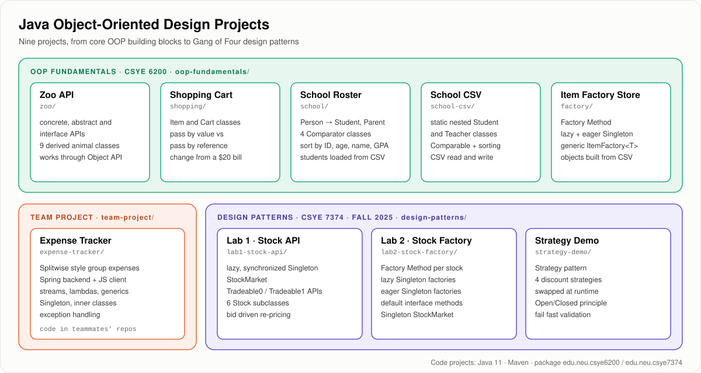
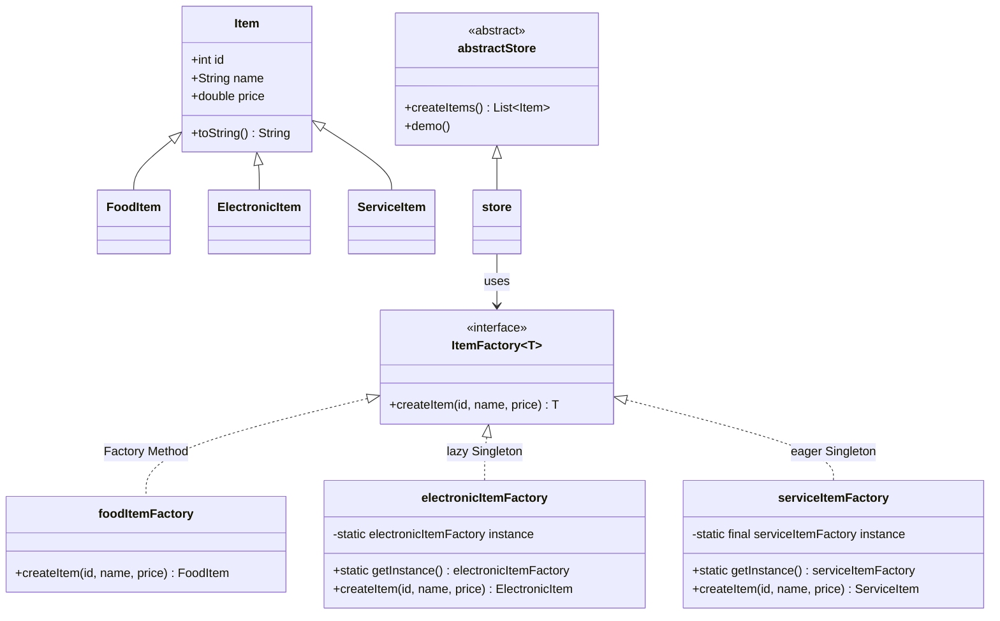
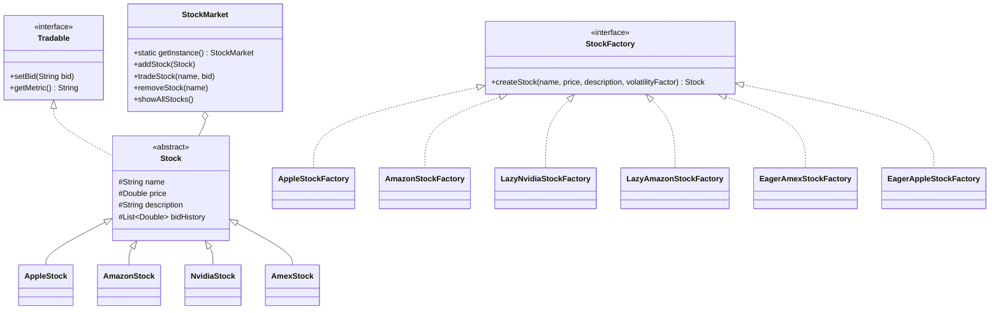
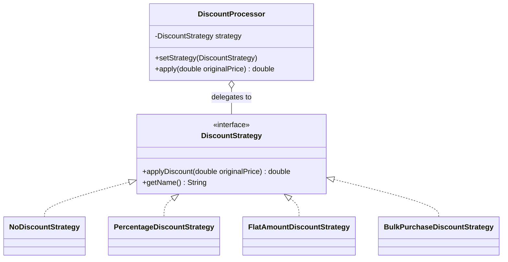
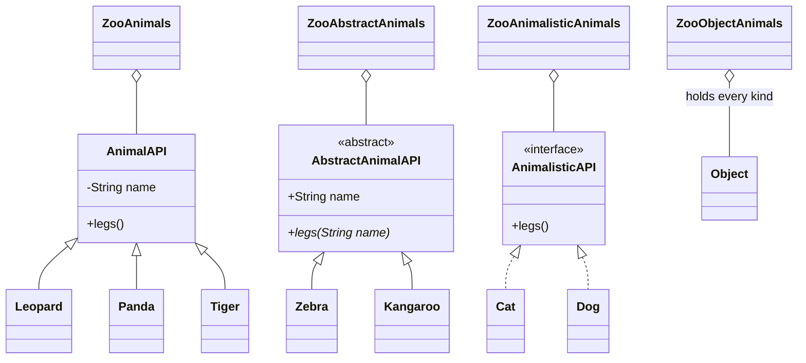

# Java Object-Oriented Design Projects

**Nine Java projects that go from core object-oriented programming (inheritance, abstraction, interfaces, polymorphism, comparators, nested classes, file I/O) to Gang of Four design patterns (Factory Method, Singleton, Strategy). Built for Northeastern University's CSYE 6200 Object-Oriented Design and CSYE 7374 Design Patterns courses.**


**Topics:** `java` `object-oriented-programming` `object-oriented-design` `oop` `design-patterns` `gang-of-four` `factory-method` `singleton-pattern` `strategy-pattern` `factory-pattern` `inheritance` `polymorphism` `abstraction` `interfaces` `generics` `comparator` `solid-principles` `maven` `java-11` `northeastern-university`

---

## Table of Contents
- [Project Map](#project-map)
- [Projects](#projects)
- [Concept Coverage](#concept-coverage)
- [Class Diagrams](#class-diagrams)
- [How to Run](#how-to-run)
- [Repository Structure](#repository-structure)
- [Skills Demonstrated](#skills-demonstrated)
- [Where These Projects Came From](#where-these-projects-came-from)
- [License](#license)

---

## Project Map



---

## Projects

### OOP Fundamentals (CSYE 6200)

| Project | Folder | What it builds | Key concepts |
|---|---|---|---|
| **Zoo API** | [`oop-fundamentals/zoo`](oop-fundamentals/zoo) | The same animal API written three ways (concrete class, abstract class, interface), 9 derived animals and 4 zoo containers | Inheritance, abstract classes, interfaces, polymorphism, inner classes, `Object` as the universal type |
| **Shopping Cart** | [`oop-fundamentals/shopping`](oop-fundamentals/shopping) | `Item` and `Cart` classes that buy items with a single $20 bill | Pass by value vs pass by reference, object state, `toString()` |
| **School Roster** | [`oop-fundamentals/school`](oop-fundamentals/school) | `School` with student and person rosters loaded from CSV | `Person` → `Student` inheritance, `Parent` composition, 4 `Comparator` classes, `Comparator.comparing` with method references |
| **School CSV** | [`oop-fundamentals/school-csv`](oop-fundamentals/school-csv) | Roster that reads students and parents from CSV and writes results back | Static nested `Student` and `Teacher` classes, `Comparable`, sorting, file read and write |
| **Item Factory Store** | [`oop-fundamentals/factory`](oop-fundamentals/factory) | Store that creates food, electronic and service items from CSV through factories, then sorts them | Factory Method, lazy Singleton, eager Singleton, generic `ItemFactory<T extends Item>`, abstract class, file I/O |

### Team Project

| Project | Folder | What it builds | Key concepts |
|---|---|---|---|
| **Expense Tracker** | [`team-project/expense-tracker`](team-project/expense-tracker) | Splitwise style app: sign up, log in, manage groups and shared expenses | Abstraction, polymorphism, inheritance, streams, lambdas, generics, Singleton, exception handling, inner classes |

The Expense Tracker code lives in my teammates' repositories; the folder links to them with credit.

### Design Patterns (CSYE 7374, Fall 2025)

| Project | Folder | What it builds | Key concepts |
|---|---|---|---|
| **Lab 1: Stock API** | [`design-patterns/lab1-stock-api`](design-patterns/lab1-stock-api) | Stock market simulation with 6 stock types that re-price on each bid | Lazy, `synchronized` Singleton `StockMarket`, abstract `Stock`, `Tradeable` interface with `Tradeable0` / `Tradeable1` base APIs |
| **Lab 2: Stock Factory** | [`design-patterns/lab2-stock-factory`](design-patterns/lab2-stock-factory) | Extends the stock program with a factory for every stock type | Factory Method, lazy Singleton factories, eager Singleton factories, default interface methods |
| **Strategy Demo** | [`design-patterns/strategy-demo`](design-patterns/strategy-demo) | Discount engine that swaps pricing rules at runtime | Strategy pattern, programming to an interface, Open/Closed principle, fail fast validation, `final` fields |

---

## Concept Coverage

| Concept | Zoo | Shopping | School | School CSV | Factory | Expense | Lab 1 | Lab 2 | Strategy |
|---|:-:|:-:|:-:|:-:|:-:|:-:|:-:|:-:|:-:|
| Inheritance | ✅ | | ✅ | ✅ | ✅ | ✅ | ✅ | ✅ | |
| Abstract classes | ✅ | | | | ✅ | ✅ | ✅ | ✅ | |
| Interfaces | ✅ | | | | ✅ | ✅ | ✅ | ✅ | ✅ |
| Polymorphism | ✅ | | ✅ | ✅ | ✅ | ✅ | ✅ | ✅ | ✅ |
| Pass by value vs reference | | ✅ | | | | | | | |
| `Comparator` / `Comparable` | | | ✅ | ✅ | ✅ | ✅ | | | |
| Inner and nested classes | ✅ | | | ✅ | | ✅ | | | |
| Generics | | | | | ✅ | ✅ | | | |
| File I/O (CSV) | | | ✅ | ✅ | ✅ | | | | |
| Default interface methods | | | | | | | | ✅ | |
| **Singleton** (lazy / eager) | | | | | ✅ | ✅ | ✅ | ✅ | |
| **Factory Method** | | | | | ✅ | | | ✅ | |
| **Strategy** | | | | | | | | | ✅ |

---

## Class Diagrams

### Item Factory Store: Factory Method + Singleton



### Lab 2: Stock Factory with lazy and eager Singletons



### Strategy Demo: discount engine



### Zoo API: one idea, three kinds of API



---

## How to Run

**Prerequisites:** JDK 11 or newer and Maven 3.

Each project is a standalone Maven project. Run it from inside its own folder, because the CSV based projects read their data files with paths relative to the project folder.

```bash
git clone https://github.com/Govindrm7/Java-Object-Oriented-Design-Projects.git
cd Java-Object-Oriented-Design-Projects

# OOP fundamentals (package edu.neu.csye6200)
cd oop-fundamentals/factory
mvn -q compile exec:java -Dexec.mainClass=edu.neu.csye6200.Driver

# Design patterns (package edu.neu.csye7374)
cd ../../design-patterns/strategy-demo
mvn -q compile exec:java -Dexec.mainClass=edu.neu.csye7374.Driver
```

| Folder | Main class |
|---|---|
| `oop-fundamentals/zoo`, `shopping`, `school`, `school-csv`, `factory` | `edu.neu.csye6200.Driver` |
| `design-patterns/lab1-stock-api`, `lab2-stock-factory`, `strategy-demo` | `edu.neu.csye7374.Driver` |

All eight code projects were compiled and run successfully with Maven 3.9 on a current JDK. Each folder also keeps its Eclipse project files, so it can be imported straight into Eclipse.

---

## Repository Structure

```text
Java-Object-Oriented-Design-Projects/
├── oop-fundamentals/
│   ├── zoo/                  # Concrete, abstract and interface APIs
│   ├── shopping/             # Pass by value vs pass by reference
│   ├── school/               # Comparator based sorting, CSV input
│   ├── school-csv/           # Nested classes, Comparable, CSV read/write
│   └── factory/              # Factory Method + lazy/eager Singleton
├── team-project/
│   └── expense-tracker/      # Splitwise style app (links to team repos)
├── design-patterns/
│   ├── lab1-stock-api/       # Singleton StockMarket, Tradeable APIs
│   ├── lab2-stock-factory/   # Factory Method + Singleton factories
│   └── strategy-demo/        # Strategy pattern discount engine
└── docs/
    └── project-map.svg       # Overview diagram used in this README
```

Every project folder keeps its own `README.md` with the original assignment requirements.

---

## Skills Demonstrated

| Area | Skills |
|---|---|
| **Core OOP** | Encapsulation, inheritance, abstraction, polymorphism, composition, designing APIs as concrete classes, abstract classes and interfaces |
| **Design patterns (GoF)** | Factory Method, Singleton (lazy, eager, thread safe with `synchronized`), Strategy |
| **Design principles** | Open/Closed, Single Responsibility, programming to an interface, fail fast validation, immutability with `final` |
| **Java language** | Generics with bounded types, inner and static nested classes, default interface methods, `Comparator` and `Comparable`, method references, collections, exception handling |
| **Data handling** | Reading and writing CSV files, building objects from text data, multi-key sorting |
| **Tooling** | Java 11, Maven, Eclipse, Git |
| **Teamwork** | Multi-person Expense Tracker project with a Spring backend and JavaScript client |

---

## Where These Projects Came From

This repository combines nine earlier repositories. Each was merged in with its **full commit history**, so `git log` still shows every original commit and date. The original repositories are archived (read-only) and point here.

| Folder | Original repository |
|---|---|
| `oop-fundamentals/zoo` | [Zoo_Object_Oriented_Design](https://github.com/Govindrm7/Zoo_Object_Oriented_Design) |
| `oop-fundamentals/shopping` | [Shopping_Java_Object_Oriented_Design](https://github.com/Govindrm7/Shopping_Java_Object_Oriented_Design) |
| `oop-fundamentals/school` | [School_Object_Oriented_Design_Project](https://github.com/Govindrm7/School_Object_Oriented_Design_Project) |
| `oop-fundamentals/school-csv` | [School_CSV_Object_Oriented_Design](https://github.com/Govindrm7/School_CSV_Object_Oriented_Design) |
| `oop-fundamentals/factory` | [Factory_Object_Oriented_Design_Project](https://github.com/Govindrm7/Factory_Object_Oriented_Design_Project) |
| `team-project/expense-tracker` | [Expense_Tracker_Object_Oriented_Design_Project](https://github.com/Govindrm7/Expense_Tracker_Object_Oriented_Design_Project) |
| `design-patterns/lab1-stock-api` | [CSYE7374-Design-Pattern-Lab1-Stock-API](https://github.com/Govindrm7/CSYE7374-Design-Pattern-Lab1-Stock-API) |
| `design-patterns/lab2-stock-factory` | [Lab-2---Stock-Factory-Lab-Design-Pattern-Java](https://github.com/Govindrm7/Lab-2---Stock-Factory-Lab-Design-Pattern-Java) |
| `design-patterns/strategy-demo` | [CSYE7374-StrategyDemo](https://github.com/Govindrm7/CSYE7374-StrategyDemo) |

During the merge, GitHub Classroom autograding files, stale `bin/` copies and `.DS_Store` files were removed, and the Expense Tracker README gained a team credit section. No source code was changed.

---

## License

Each code project carries the GNU General Public License v3.0 in its own `LICENSE` file.
